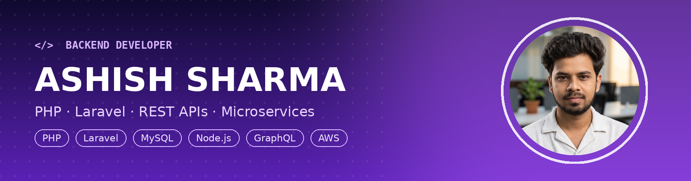

<!-- Replace/add ashish-banner.png in your profile repository -->

  

<h1 align="center">Ashish Sharma</h1>
<h3 align="center">Senior Backend Developer specializing in Laravel, microservices, system design, and performance optimization</h3>

  
  
  

  <a href="https://ashish-sharma-portfolio.pages.dev"><strong>↗ Visit my portfolio — projects, experience & technical journey</strong></a>

---

## 👋 About Me

I'm a backend-focused engineer with **6+ years of experience** building, modernizing, and optimizing web applications and backend services. My work centers on **Laravel, PHP, microservices, API design, system design, and database performance**—with ownership from implementation through production.

- 🔭 Currently building and improving backend services at **Molitics Infomedia**
- ⚙️ Focused on scalable APIs, maintainable architecture, caching, and performance
- ☁️ Experienced with AWS, Docker, CI/CD, and production deployments
- 🧩 Worked across Laravel, Lumen, Node.js, and Python service repositories
- 👨‍🏫 Mentored junior engineers and helped standardize code and delivery practices
- 📍 Delhi, India

---

## 🧰 Tech Stack

### Backend & API

  

**Also:** Lumen · REST APIs · GraphQL · Eloquent · Queues · Event-driven systems

### Data, Cache & Search

  

### Cloud, DevOps & Tools

  

**AWS:** EC2 · S3 · RDS · SQS · Docker Compose · CI/CD

### Frontend

  

---

## 🚀 Featured Work

### 🚕 [Zeo Taxi — Cab Booking & CRM](https://www.zeotaxi.com/)
**Independent end-to-end development · Laravel · MySQL · JavaScript · AJAX · Bootstrap**

- Built a cab-booking platform and CRM from the ground up.
- Developed booking flows, vendor and driver management, and payment-related modules.
- Created CRM dashboards for operational insights and booking management.
- Integrated REST APIs and Google Distance Matrix; handled deployment through production.

**Links:** [Website](https://www.zeotaxi.com/) · [CRM](https://crm.zeotaxi.com/)

### 🏗️ [Molitics — Social & News Platform](https://molitics.in/)
**Microservices · Laravel · Lumen · Node.js · Python · GraphQL · MySQL · Redis · Elasticsearch**

- Developed and maintained services across a multi-repository backend.
- Refactored legacy modules into cleaner, SOLID-aligned service layers.
- Optimized MySQL queries, indexing, and response handling; applied Redis caching.
- Improved API response times by up to **30%** and supported frontend integration with documented APIs.

### 📊 Softintra CRM
**Laravel · CodeIgniter · PHP · MySQL**

- Worked on CRM features for projects, teams, attendance, leads, sales, and expenses.
- Led Core PHP modernization to Laravel and CodeIgniter across **10+ applications**.
- Built reusable modules, role-based permissions, integrations, and payment workflows.

### 💰 Smart Feel Trade
**Laravel · PHP · MySQL**

- Built MLM/business platform features around bonuses, rewards, cashback, wallets, and analytics.

---

## 💼 Experience

| Role | Company | Period |
|---|---|---|
| **Senior Backend Developer** | Molitics Infomedia | Nov 2024 – Present |
| **Full Stack Developer** | Softintra Technology | Mar 2021 – Sep 2024 |
| **PHP Developer** | Bharat Taxi | Mar 2020 – Feb 2021 |

<strong>Highlights from my experience</strong>

- Backend refactoring and query/caching improvements contributed to **30% faster API response times**.
- Standardized code patterns and backend restructuring helped reduce development time by **30%**.
- Led Core PHP migrations to Laravel/CodeIgniter across **10+ applications**.
- Mentored **5 junior developers**; delivered features across backend and frontend for multiple client projects.

---

## 📌 Engineering Interests

`System Design` · `Microservices` · `Distributed Systems` · `Performance Engineering` · `Caching` · `Search` · `API Design` · `Event-Driven Architecture` · `Clean Architecture` · `SOLID`

---

## 📊 GitHub Snapshot

  
  

  

---

## 🤝 Let's Connect

  
  
  
  
  

<em>Open to backend engineering opportunities, collaboration, and conversations about Laravel, scalable systems, and system design.</em>

<strong>Let's build something great. 🚀</strong>

